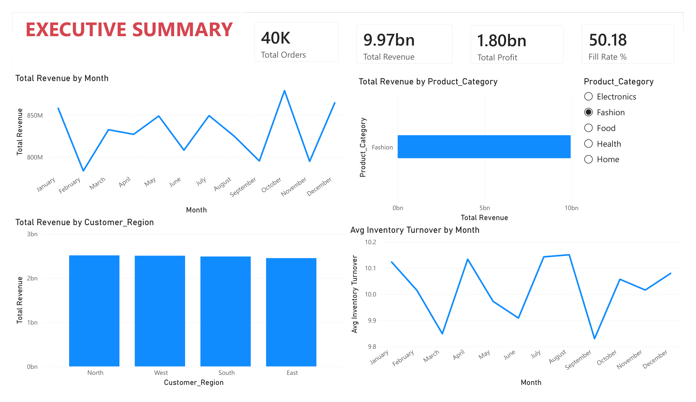
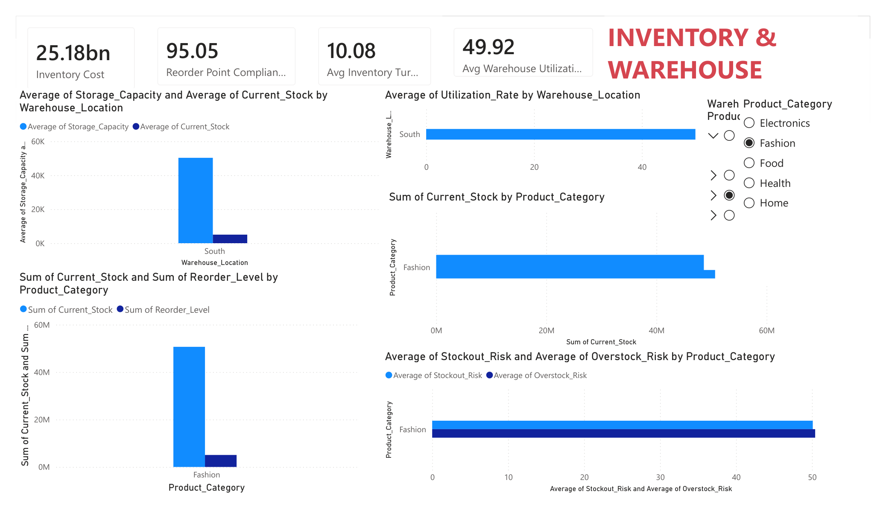
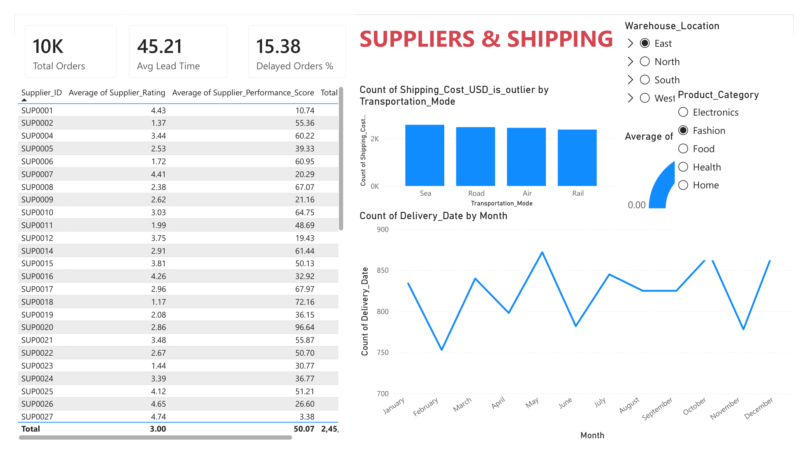
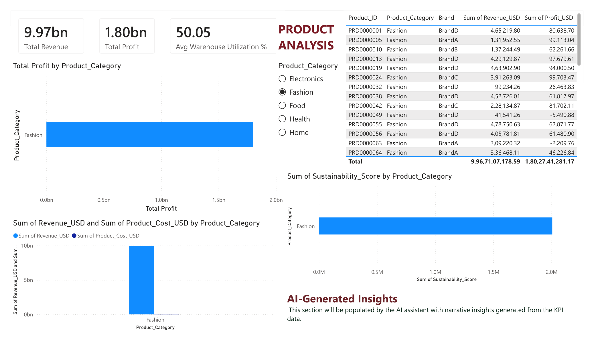
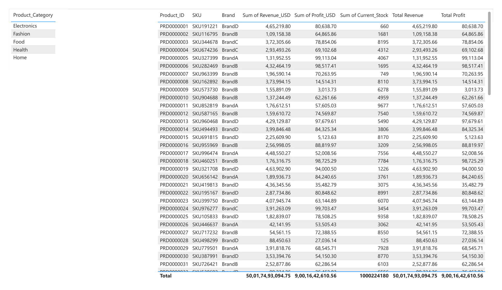

# AI-Assisted Supply Chain Optimization Dashboard

An end-to-end supply chain analytics project that transforms raw retail and logistics data into actionable business insights. The project combines Python-based data cleaning and exploratory analysis, SQL-driven KPI analysis, and an interactive Power BI dashboard to evaluate operational performance across inventory, warehouses, suppliers, shipping, and product categories.

Designed as a portfolio project demonstrating practical skills in **Data Analytics, Business Intelligence, SQL, Python, and Power BI**.

## Dashboard Preview

**Executive Summary**



**Inventory & Warehouse Analysis**



**Supplier & Shipping Analysis**



**Product Analysis**



**Category Drillthrough**



The repository includes a Power BI template (`powerbi/supply_chain_dashboard.pbit`) and a PDF dashboard export (`dashboard/dashboard_export.pdf`).

To explore the dashboard, open the template in Power BI Desktop and configure the data source using the processed dataset provided in `data/processed/`.

## Tech Stack

- **Python** — Pandas, NumPy for data cleaning, preprocessing, feature engineering, and exploratory data analysis.
- **SQL (MySQL)** — Database creation, KPI analysis, CTEs, window functions, ranking, and business queries.
- **Power BI** — Interactive dashboards, DAX measures, Power Query, drillthrough, and business performance reporting.
- **Data Analytics** — EDA, KPI development, trend analysis, inventory analysis, and supplier performance evaluation.
- **Git & GitHub** — Version control and project documentation.

## Key Analytical Areas

- Revenue and profitability trends
- Inventory turnover and warehouse utilization
- Supplier performance and shipment delays
- Product and category-level performance
- ABC analysis and product ranking
- Moving averages and monthly trend analysis
- Operational KPI monitoring and business insights

## Project Structure

```text
AI-Supply-Chain-Optimisation/
│
├── data/
│   └── processed/
│       ├── cleaned_supply_chain.csv
│       └── kpi_summary.json
│
├── docs/
│   ├── business_problem.md
│   ├── data_dictionary.md
│   ├── dataset_selection.md
│   ├── eda_findings.md
│   ├── kpi_summary.md
│   └── profiling_summary.txt
│
├── images/
│   ├── correlation_heatmap.png
│   ├── dashboard_executive_summary.png
│   ├── dashboard_inventory_warehouse.png
│   ├── dashboard_supplier_shipping.png
│   ├── dashboard_product_analysis.png
│   ├── dashboard_category_detail.png
│   ├── monthly_revenue_trend.png
│   ├── profit_distribution.png
│   └── revenue_by_category.png
│
├── powerbi/
│   └── supply_chain_dashboard.pbit
│
├── python/
│   ├── 01_dataset_understanding.py
│   ├── 02_data_cleaning.py
│   ├── 03_load_to_mysql.py
│   ├── 04_eda.py
│   └── 05_kpi_calculation.py
│
├── sql/
│   ├── 01_create_database.sql
│   ├── 02_top_suppliers.sql
│   ├── 03_delayed_shipments.sql
│   ├── 04_inventory_turnover.sql
│   ├── 05_warehouse_utilization.sql
│   ├── 06_monthly_trends.sql
│   ├── 07_abc_analysis.sql
│   ├── 08_moving_averages.sql
│   └── 09_ranking_window_functions.sql
│
├── dashboard/
│   └── dashboard_export.pdf
│
├── .env.example
├── .gitignore
└── README.md
```

## Project Workflow

1. **Dataset Understanding** — Examined the dataset, its structure, variables, and business relevance.
2. **Data Cleaning** — Processed missing values, prepared fields, and generated a cleaned dataset.
3. **Database Setup** — Created the MySQL database and prepared the data-loading workflow.
4. **SQL Analysis** — Developed analytical queries for supplier performance, shipping delays, inventory, and warehouse operations.
5. **Exploratory Data Analysis** — Used Python to investigate distributions, relationships, and business trends.
6. **KPI Calculation** — Computed key operational and business performance metrics.
7. **Power BI Dashboard** — Built interactive views for executive reporting and detailed operational analysis.

## Current Build Status

- [x] Dataset understanding and profiling
- [x] Data cleaning and preprocessing
- [x] MySQL database setup scripts
- [x] SQL business analysis queries
- [x] Python exploratory data analysis
- [x] KPI calculation
- [x] Power BI dashboard and PDF export
- [ ] AI-assisted business recommendations
- [ ] Final documentation and deployment enhancements

## Getting Started

1. Clone this repository.
2. Install the required Python dependencies.
3. Configure your MySQL database.
4. Run the Python scripts in sequence.
5. Execute the SQL scripts for analytical queries.
6. Open the Power BI template and configure the processed dataset as its data source.

Refer to the `docs/` directory for the business problem, dataset selection, data dictionary, EDA findings, and KPI documentation.

---

**Author:** K Varshit

**Focus Areas:** Data Analytics | Business Intelligence | SQL | Python | Power BI
